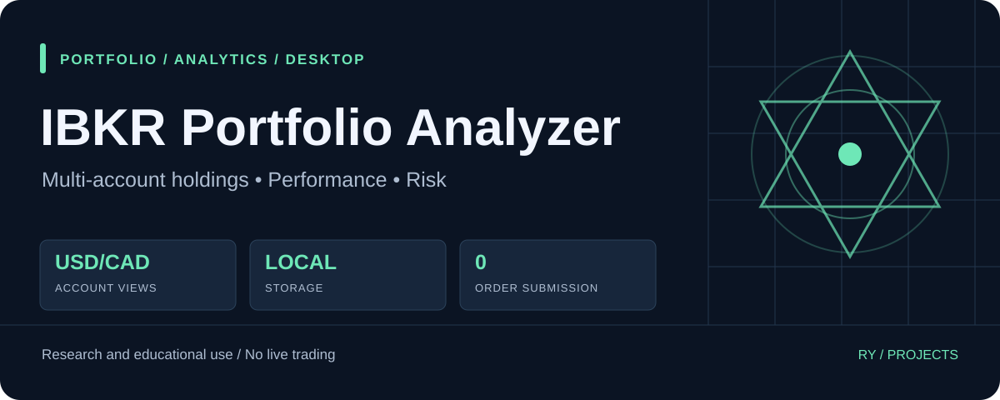
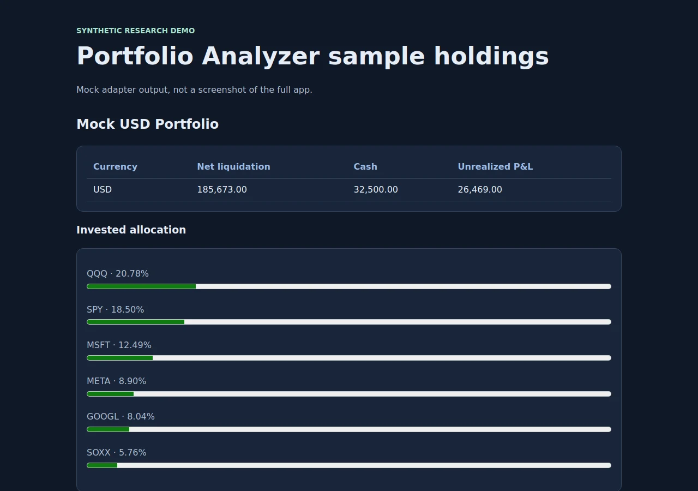
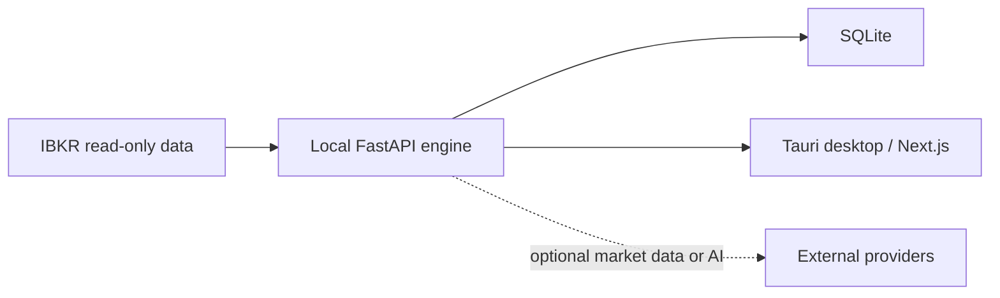

<p align="center">
  
</p>

# IBKR Portfolio Analyzer

[English](README.md) · [简体中文](README.zh-CN.md)

**Understand your IBKR portfolio without giving an app permission to trade.**

Local-first desktop analytics for holdings, performance, risk and research. Built with Tauri, Next.js, FastAPI and SQLite.

[Try the demo](#try-the-demo) · [Quick start](#quick-start) · [Documentation](#documentation) · [Roadmap](ROADMAP.md) · [FAQ](FAQ.md) · [Contribute](CONTRIBUTING.md)

[](https://github.com/RyanYang053/ibkr-portfolio-analyzer/actions/workflows/ci.yml)


[](https://github.com/RyanYang053/ibkr-portfolio-analyzer/stargazers) [](https://github.com/RyanYang053/ibkr-portfolio-analyzer/forks)
[](https://github.com/RyanYang053/ibkr-portfolio-analyzer/actions/workflows/public-demo.yml) [](https://github.com/RyanYang053/ibkr-portfolio-analyzer/issues) [](CONTRIBUTING.md)

## Try the demo



[Download the self-contained HTML demo](docs/assets/portfolio-demo.html) · [Preview provenance and checksums](docs/assets/PREVIEW.md)

The image above is a real browser capture of the fixture report, not the full production UI. Download the HTML file and open locally; no brokerage login or network service is required.

No personal portfolio, API key or live brokerage session is needed. [Open the public demo workflow](https://github.com/RyanYang053/ibkr-portfolio-analyzer/actions/workflows/public-demo.yml), select a successful run from the branch you want to inspect, download its preview artifact (HTML and PNGs), unzip it and open `portfolio-demo.html`. GitHub may require sign-in to download an artifact; artifacts expire. The source-checkout commands below work independently of GitHub artifact availability.

The demo is generated from fixture data, not a marketing mock-up, live market quote or financial performance claim.

## Quick start

```bash
git clone https://github.com/RyanYang053/ibkr-portfolio-analyzer.git
cd ibkr-portfolio-analyzer
python -m venv .venv
```

Activate with `source .venv/bin/activate` on macOS/Linux or `.venv\Scripts\Activate.ps1` in PowerShell.

```bash
python -m pip install -r ai-portfolio-intelligence/apps/api/requirements.txt
python scripts/demo.py --output portfolio-demo.html
```

Open the generated HTML file locally. A small HTML preview generated from the actual mock broker adapter, showing fictional accounts and holdings. It is not the full desktop UI and uses no brokerage credentials.

## What you can explore

| Area | Capability |
| --- | --- |
| Accounts | USD/CAD holdings, multi-account views, Flex ingestion |
| Performance | Historical valuations, P&L, benchmark and return analysis |
| Risk | Drawdown, volatility, concentration and risk metrics |
| Research | Securities workspace, charts, screening, optional AI |
| Workflow | Tax estimates, journal and draft trade plans; no submitted orders |



## Desktop setup

See the [platform and capability matrix](docs/PLATFORM_SUPPORT.md) for the difference between available source workflows and verified public installers.

- [Desktop architecture and local smoke tests](ai-portfolio-intelligence/README.md)
- [IBKR read-only connection](ai-portfolio-intelligence/docs/ibkr-readonly-setup.md)
- [Release and signing](ai-portfolio-intelligence/docs/RELEASE_AND_SIGNING.md)
- [Product scope](ai-portfolio-intelligence/docs/PRODUCT_SCOPE.md)

**Release status:** no published desktop installers at the time of this update. Source checkout only; check CI and release certification before deployment. Do not bypass OS security to install unverified builds.

The local desktop engine uses a loopback-only API. Optional AI and data providers can make network requests; review their data flows and policies before enabling them. Never share real account statements or tokens. No order execution.

## Verification

```bash
cd ai-portfolio-intelligence/apps/api && python -m pytest tests -q
```

See [engineering reference](ENGINEERING.md) for the preserved previous technical documentation, [launch gates](docs/LAUNCH.md) and [license status](LICENSING.md).

## Documentation

| Resource | Start here |
| --- | --- |
| First use | [Quick start](#quick-start) |
| Technical detail | [Engineering reference](ENGINEERING.md) · [Platform and capability matrix](docs/PLATFORM_SUPPORT.md) |
| Frequently asked questions | [FAQ](FAQ.md) |
| Current plans and gaps | [Roadmap](ROADMAP.md) · [Vision](VISION.md) |
| Changes | [Changelog](CHANGELOG.md) |
| Security and privacy | [Security policy](SECURITY.md) |
| Licensing | [License status](LICENSING.md) |
| Contribution process | [Contributing](CONTRIBUTING.md) · [Code of conduct](CODE_OF_CONDUCT.md) · [Support](SUPPORT.md) |
| Releases | [GitHub Releases](https://github.com/RyanYang053/ibkr-portfolio-analyzer/releases) (check current availability) |
| Research reference | [Citation metadata](CITATION.cff) |

## Related projects

- [Atlas Investment OS](https://github.com/RyanYang053/50agent-invest-system) — Local-first research, valuation, quantitative analysis, risk and governance.
- [IBKR Agent Harness](https://github.com/RyanYang053/IBKR-Agent-harness) — Local-first Python and MCP toolkit for Interactive Brokers portfolio research, combining deterministic calculations, investment policy checks, valuation and persistent workflows with human approval.

These are separate projects, not a claimed integrated deployment.

## Contributing

See [CONTRIBUTING.md](CONTRIBUTING.md) and [SECURITY.md](SECURITY.md). If the project is useful, consider starring it or reporting a reproducible improvement.

Research and educational use only; not financial or tax advice.
