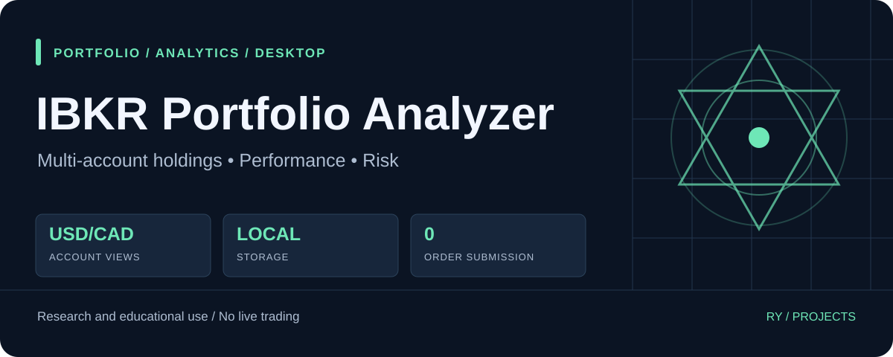

<p align="center"></p>

# IBKR Portfolio Analyzer

[English](README.md) · [简体中文](README.zh-CN.md)

本地优先的多账户投资组合分析桌面应用：持仓、表现、风险与研究。

[快速开始](#快速开始) · [项目演示](#项目演示) · [功能与运行平台](docs/PLATFORM_SUPPORT.md) · [路线图](ROADMAP.md) · [参与贡献](CONTRIBUTING.md)

## 项目演示

无需真实券商账户或模型 API Key。打开 [GitHub Actions 演示工作流](https://github.com/RyanYang053/ibkr-portfolio-analyzer/actions/workflows/public-demo.yml)，选择成功的运行，下载 HTML 预览文件；也可按以下命令在本地生成。演示采用合成数据，并非实际收益或完整部署证明。

## 快速开始

```bash
git clone https://github.com/RyanYang053/ibkr-portfolio-analyzer.git
cd ibkr-portfolio-analyzer
python -m venv .venv
```

macOS/Linux 使用 `source .venv/bin/activate` 激活环境，Windows PowerShell 使用 `.\.venv\Scripts\Activate.ps1`。

```bash
python -m pip install -r ai-portfolio-intelligence/apps/api/requirements.txt
python scripts/demo.py --output portfolio-demo.html
```

使用浏览器打开生成的文件。

## 技术文档与限制

[桌面应用](ai-portfolio-intelligence/README.md) · [IBKR 只读配置](ai-portfolio-intelligence/docs/ibkr-readonly-setup.md)

只读模式，不支持下单。可选云端 AI 和数据提供商可能联网。签名安装包尚待安全审计及发布验收。

[常见问题](FAQ.md) · [更新日志](CHANGELOG.md) · [安全说明](SECURITY.md) · [许可状态](LICENSING.md)。

## 相关项目

- [Atlas Investment OS](https://github.com/RyanYang053/50agent-invest-system)
- [IBKR Agent Harness](https://github.com/RyanYang053/IBKR-Agent-harness)

这些仓库独立维护，并非已经完成端到端技术集成。仅供研究和教育用途，不构成金融建议。
